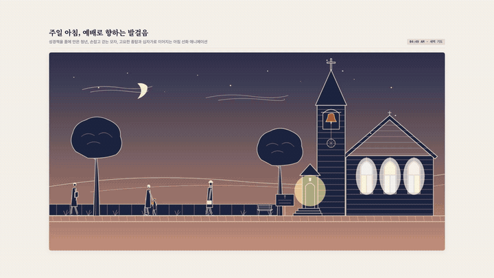

# ✒️ Line-art Animation (AI Agent Skill & TS Library)

> **Line-art Animation**은 따뜻한 종이 위에 얇은 먹선으로 그린 듯한 인물, 동물, 풍경 및 낮·밤 주기를 연출하는 **AI 에이전트 스킬**(Agent Skill)이자 **초경량 무의존성 TypeScript SVG 애니메이션 라이브러리**이다.

이 저장소는 [JDhruv14/line-art-animation](https://github.com/JDhruv14/line-art-animation) 원작을 바탕으로, 한국어 에이전트 프롬프팅 최적화와 실패 방지 가이드라인([`references/gotchas.md`](./references/gotchas.md))을 보강하여 표준 헌장(A-Grade) 규격으로 정비한 버전이다.

---

## 🌟 주요 특징 (Key Features)

- **역운동학 기반 보행 연산**(IK Gait Solver):
  단순한 사인파 바운스가 아닌 지면에 닿은 발이 정확히 멈춰 서서 지탱되는 물리적 보행(`gait.ts`)을 구현하여 발 미끄러짐(Foot Skating)을 원천 차단한다.
- **스프링 및 진자 물리**(Spring & Pendulum Physics):
  보행 가속도와 마우스 포인터 바람에 따라 목도리, 가방, 옷자락, 나뭇가지가 관성을 갖고 자연스럽게 출렁인다(`motion.ts`).
- **낮·밤 반전 팔레트**(Day/Night Palette Cycle):
  주간(미색 종이 위 진한 먹선)에서 야간(인디고 종이 위 연한 먹선과 창문/등불의 따뜻한 발광)으로 매끄럽게 색상이 반전된다(`daynight.ts`).
- **무의존성 순수 DOM/SVG**(Zero Dependencies):
  외부 런타임 라이브러리 없이 순수 브라우저 표준 SVG로 구동되며, 60 FPS 부드러운 프레임레이트를 보장한다.
- **실패 방지 가이드라인**(Gotchas Guardrails):
  에이전트가 흔히 범하는 안티패턴(기계적 직선 사지, 폐쇄형 튜브, 타임랩스 배속 왜곡, 헤드리스 rAF 스로틀링)을 방지하는 정밀 가이드를 내장한다.

---

## 🎬 실전 작품 쇼케이스 (Production Showcase)

스킬을 통해 제작된 실제 복합 장면 예시이다. 단일 인물 보행을 넘어 다중 인물, 24시간 천체 순환, 오디오 합성 및 1080p 헤드리스 비디오 추출까지 전체 파이프라인을 보여준다:

### 주일 아침, 예배로 향하는 발걸음 (Sunday Church Walk)



- **1080p 고화질 영상**(MP4): [media/church-walk-1080p.mp4](./media/church-walk-1080p.mp4) (1920×1080, 30fps, 18초, 3.1MB)
- **웹 라이브 인터랙티브 데모**: [https://kerygma.co.kr/church-walk/](https://kerygma.co.kr/church-walk/)
- **독립 실행 소스 코드**: [`examples/church-walk/index.html`](./examples/church-walk/index.html)
- **구현된 핵심 기술**:
  - **다중 인물 역운동학 보행**: 성경책을 품은 청년(`walk`), 손잡고 걷는 어머니와 아이(`walk` 및 아동 `shuffle`), 중절모를 쓰고 가죽 가방을 흔드는 노장로님(`pendulum`)의 개별 보행 연산
  - **24시간 연속 천체 순환**: 새벽 여명, 아침 햇살, 정오, 서쪽 노을, 그리고 초승달과 깜빡이는 별무리로 이어지는 태양 포물선 궤적
  - **건축 및 빛의 연출**: 높은 뾰족 종탑과 라틴 십자가, 어둠이 내리면 성당 스테인드글라스 창문과 문틈에서 새어 나오는 따뜻한 호박색 실내등 발광
  - **음향 및 생태계 인터랙션**: Web Audio API 및 오프라인 배음 합성을 통한 맑은 청동 종소리, 종이 울릴 때 지붕 처마에서 놀라 날아오르는 참새 무리

---

## 🚀 에이전트 스킬 설치 (Installation)

사용하는 AI 코딩 에이전트에 맞춰 터미널에서 아래 한 줄 명령어를 실행하면 즉시 스킬이 등록된다.

### 1. Claude Code 사용자
```bash
git clone https://github.com/mitmirsein/line-art-animation ~/.claude/skills/line-art-animation
```

### 2. Google Antigravity / Gemini CLI 사용자
```bash
git clone https://github.com/mitmirsein/line-art-animation ~/.gemini/config/skills/line-art-animation
```

### 3. 프로젝트 전용 설치 (Cursor, Codex, 협업 워크스페이스)
작업 중인 프로젝트 루트 경로에서 실행:
```bash
git clone https://github.com/mitmirsein/line-art-animation .skills/line-art-animation
```

---

## 💬 사용법 예시 (Prompting Examples)

스킬을 설치한 후, 에이전트에게 자연어로 자유롭게 지시할 수 있다:

- "새벽 골목길을 걸어가는 사람과 창문에서 새어 나오는 불빛의 라인아트 애니메이션 카드 만들어줘"
- "비 오는 날 우산을 쓰고 종종걸음으로 걷는 아이의 SVG 컴포넌트 짜줘"
- "성경책을 품에 안고 교회로 향하는 사람들의 아침 선화 애니메이션을 만들어줘"
- "현재 장면에 낮밤 주기를 넣고 30초짜리 1080p MP4 영상으로 추출해줘"

---

## 🛠️ 로컬 예제 실행 (Local Development)

내장된 데모 예제(`Walker`, `Village`)를 로컬 웹 브라우저에서 실행할 수 있다:

```bash
# 1. 저장소 클론
git clone https://github.com/mitmirsein/line-art-animation.git
cd line-art-animation

# 2. 의존성 설치 및 개발 서버 시작
npm install
npm run dev
```

브라우저에서 `http://localhost:5173`으로 접속하면 예제를 확인할 수 있다.

---

## 🎬 헤드리스 비디오 렌더링 (Video Export)

결정론적 캡처 스크립트(`scripts/capture.ts`)와 `ffmpeg`를 통해 1080p 고화질 비디오나 GIF로 렌더링할 수 있다:

```bash
# 1. 프레임 캡처 (Node 22)
node --experimental-strip-types scripts/capture.ts "http://localhost:5173/examples/village/?debug" captures/village 900 30 1920 1080

# 2. MP4 비디오 인코딩
ffmpeg -framerate 30 -i captures/village/f%04d.png -c:v libx264 -preset slow -crf 15 -pix_fmt yuv420p -tune animation village.mp4

# 3. 움직이는 GIF 인코딩
ffmpeg -framerate 15 -i captures/village/f%04d.png -vf "scale=800:-1:flags=lanczos,split[a][b];[a]palettegen[p];[b][p]paletteuse" village.gif
```

---

## 📂 저장소 구조 (Repository Structure)

```text
line-art-animation/
├── SKILL.md                  # 에이전트 지침서 (Phase 0~6 한국어 워크플로우)
├── lib/                      # 무의존성 핵심 TS 모듈
│   ├── ink.ts                # 펜선, 사지(limb), 종이/잉크 렌더 루프
│   ├── gait.ts               # 역운동학 보행 연산 엔진 (walk, shuffle, run)
│   ├── motion.ts             # 스프링 물리, 진자 운동, 포인터 바람
│   └── daynight.ts           # 24시간 하늘·종이·잉크 팔레트 및 반전
├── references/               # 상세 기법 가이드
│   ├── gotchas.md            # [필수] 실패 사례 및 안티패턴 방지 가이드
│   ├── style.md              # 펜 굵기, 색상, 종이 질감, 인물 비율
│   ├── motion.md             # 보행 역학, 관성, 스프링 물리
│   ├── scenes.md             # 레이어 구조, 낮밤 전환, 인터랙션
│   ├── verify.md             # 프레임 단위 정밀 검증 기법
│   ├── video.md              # 비디오 및 GIF 렌더링 파이프라인
│   └── matching.md           # 실측 기반 레퍼런스 클립 모사
├── scripts/                  # 결정론적 캡처 및 클립 분석 스크립트
├── media/                    # 고해상도 비디오(MP4) 및 GIF 쇼케이스 자산
└── examples/                 # 참조 예제
    ├── walker/               # 단일 인물 보행 예제 (~150줄)
    ├── village/              # 낮밤 주기를 포함한 일본풍 거리 풍경
    └── church-walk/          # 24시간 천체 순환 및 3인 보행 실전 예제
```

---

## 📜 출처 및 라이선스 (Attribution & License)

- 원작 라이브러리 및 디자인: [JDhruv14/line-art-animation](https://github.com/JDhruv14/line-art-animation)
- 한국어 에이전트 규격 정비 및 가드레일: [mitmirsein](https://github.com/mitmirsein)
- 라이선스: [MIT License](./LICENSE)
